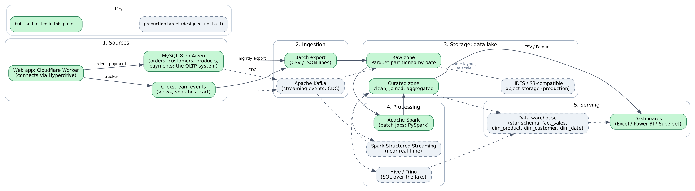

# Big Data architecture (Stage 7)

Solid green boxes were built and tested in this project. Dashed grey boxes are the production target: they are explained here and designed, but not installed. That split is deliberate, so the demo shows only what really runs.

## Purpose of each technology

| Layer | Technology | Purpose in this system | Status |
| --- | --- | --- | --- |
| Source | **MySQL** | The transactional (OLTP) system. Enforces the business rules (stock, order states, payments) and is the single source of truth for orders. Not designed for heavy reporting over billions of rows. | Built, hosted on Aiven (MySQL 8) |
| Source | **Web app (Cloudflare Worker)** | Runs on Cloudflare: customers browse and buy, staff manage orders. Reaches MySQL on Aiven through Hyperdrive. Also emits the click events a tracker would send. | Built (Cloudflare Worker) |
| Source | **Clickstream events** | Views, searches, add-to-cart and checkout steps. High volume, append-only, semi-structured, so it does not belong in the relational schema. | Synthetic file, 27,155 events |
| Ingestion | **Batch export** | Copies tables to CSV and events to JSON lines. Personal data (names, emails, phones, password hashes) is dropped at export. Simple and enough for nightly reporting. | Built |
| Ingestion | **Apache Kafka** | A durable, ordered event log. Takes order changes (change data capture) and click events as they happen, and lets several consumers read the same stream. Needed when "yesterday's data" is no longer fast enough. | Designed |
| Storage | **Data lake: HDFS or S3-compatible object storage** | Cheap, replicated, practically unlimited storage for raw and curated files. Keeps the raw data so any result can be recomputed. | Designed (local folder used) |
| Storage | **Parquet files, partitioned by date** | Columnar, compressed file format. A query reads only the columns and the date folders it needs. | Built: 28% of the JSON size, 1 of 365 partitions read for a one-day query |
| Processing | **Apache Spark** | Distributed processing engine. The same PySpark job runs on a laptop or on a cluster; Spark splits the data into partitions and processes them in parallel. | Built (local mode) |
| Processing | **Spark Structured Streaming** | Processes the Kafka stream continuously, for live counters such as sessions in the last five minutes. | Designed |
| Processing | **Hive or Trino** | SQL engine over the lake files, so analysts keep writing SQL (the 15 queries carry over) against data too large for MySQL. | Designed |
| Serving | **Data warehouse (star schema)** | Subject-oriented tables built for analysis: a sales fact table plus product, customer, city and date dimensions. Gives fast, stable numbers to dashboards. | Designed |
| Serving | **Excel, Power BI or Superset dashboards** | Where decisions are made: charts and tables for managers. | Built (3 charts in `charts/`, plus the Reports page of the web app) |

## Data flow in the prototype
1. `bigdata/export_to_csv.py` exports five tables from MySQL to CSV (160 orders, 294 order lines, 30 products, 157 payments, 42 customers, no personal data).
2. `bigdata/generate_clickstream.py` produces 27,155 events in 6,157 sessions. The 157 purchase sessions are tied to the 157 non-cart orders in the database, so the two sources can be cross-checked.
3. `bigdata/spark_analytics.py` writes the raw events to date-partitioned Parquet (the raw zone), reproduces Stage 4 Q1 and Q3 in Spark, and builds curated tables the SQL schema cannot produce: the shopping funnel, product conversion, top searches and sessions by city.
4. `bigdata/verify_match.py` compares Spark with MySQL. Result: Q1 (30 products) and Q3 (13 months) have 0 mismatches, and 157 purchase sessions equal 157 non-cart orders.

## Why this layout
- **OLTP and analytics are kept apart.** Heavy reports run on copies in the lake, so they cannot slow down checkout.
- **Raw data is kept unchanged.** The curated zone can be rebuilt at any time if a definition (for example "revenue") changes.
- **SQL skills carry over.** Spark SQL and Hive accept the same SELECT, JOIN, GROUP BY and window functions used in Stage 4.
